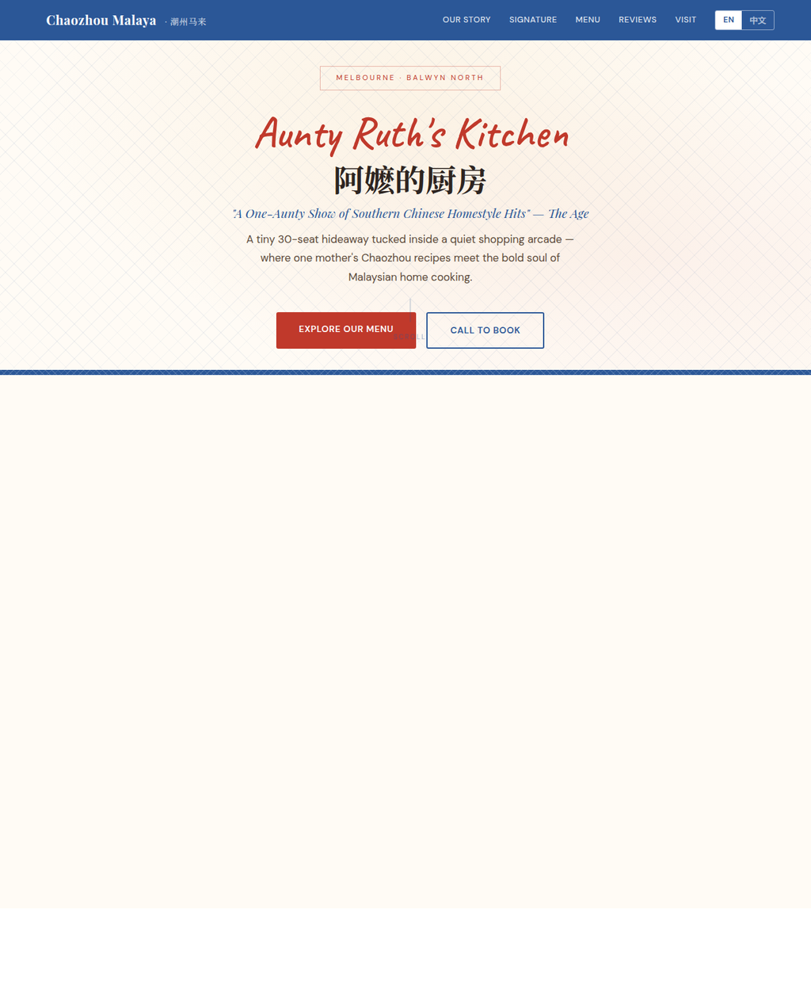

# Chaozhou Malaya Bistro Cafe — 阿嬷的厨房

A bilingual (EN / 中文) single-file website for **Chaozhou Malaya Bistro Cafe** — a mother-daughter Teochew × Malaysian Chinese kitchen in Balwyn North, Melbourne.
*(The Age Critics' Pick · 14.5/20)*

**Live:** https://12345666ddwa.github.io/chaozhou-malaya/ — or open `index.html` in any browser.

## About this build

- **Single-file `index.html`** + compressed on-site photography in `photos_web/`.
- Full restaurant site: hero, story, signature dishes, tabbed menu, reviews, visit & contact.
- **EN / 中文 language toggle.**
- Design follows the restaurant's actual character: a small "one-aunty" kitchen with a you-know-it-when-you-know-it following — warm, homey, family-run.

Design & build: Xing Gao — part of a **restaurant website portfolio**.

## Notes

Photography, brand and menu belong to Chaozhou Malaya; shown here as part of the portfolio preview.
